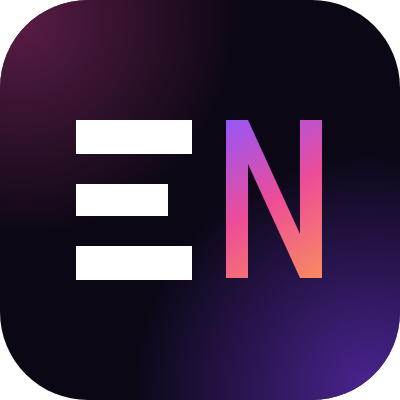

# EnrichedNow MCP server



A hosted MCP server that gives AI agents 450+ ready-made scrapers as tools: search a job board, a map, a shop or a
news site and get clean, structured records back. Sign in with OAuth or an API key. 1,000 free units a month.

There is nothing to install. This repository holds the connection details and the registry entry
([`server.json`](server.json)); the server itself is a hosted service run by [EnrichedNow](https://enrichednow.com).

| | |
| --- | --- |
| Address | `https://api.enrichednow.com/mcp` |
| Transport | Streamable HTTP |
| Authentication | OAuth (sign in from the client), or an API key in the header `Authorization: Bearer <key>` |
| Cost | A tool call costs what the same API call costs. Every account gets 1,000 free units a month. |
| Docs | https://docs.enrichednow.com/mcp/ |

Create an account and an API key at https://app.enrichednow.com/signup.

## Sign in, with no key

A client that supports MCP's sign-in (OAuth) needs the address and nothing else. It opens the EnrichedNow console in
your browser; log in, check which application is asking, and choose **Allow**.

| Client | How |
| --- | --- |
| Claude Code | `claude mcp add --transport http enrichednow https://api.enrichednow.com/mcp`, then `/mcp` inside Claude Code and choose to authenticate |
| Claude Desktop and claude.ai | **Customize**, **Connectors**, **Add custom connector**, enter the address, then **Connect** |
| Cursor | Add the server with its `url` only (no `headers`) in `mcp.json`; Cursor offers to log in |
| VS Code | Add the server with its `url` only; VS Code asks to sign in when the server starts |

Connected applications are listed in the console under **Connected apps**, where **Disconnect** stops one at once.
The server's protected-resource metadata (RFC 9728) is at
`https://api.enrichednow.com/.well-known/oauth-protected-resource/mcp`; clients register themselves (RFC 7591) and use
the authorization code flow with PKCE.

## Connect with an API key

Create a key in the console under **API keys**. The examples read it from the environment variable
`ENRICHEDNOW_API_KEY`.

### Claude Code

```bash
claude mcp add --transport http enrichednow https://api.enrichednow.com/mcp \
  --header "Authorization: Bearer $ENRICHEDNOW_API_KEY"
```

Add `--scope user` to have it in every project. To share it with a team, put this in `.mcp.json` at the root of the
project; the key stays in each person's environment:

```json
{
  "mcpServers": {
    "enrichednow": {
      "type": "http",
      "url": "https://api.enrichednow.com/mcp",
      "headers": {
        "Authorization": "Bearer ${ENRICHEDNOW_API_KEY}"
      }
    }
  }
}
```

### Cursor

In `~/.cursor/mcp.json` (every project) or `.cursor/mcp.json` (one project):

```json
{
  "mcpServers": {
    "enrichednow": {
      "url": "https://api.enrichednow.com/mcp",
      "headers": {
        "Authorization": "Bearer ${env:ENRICHEDNOW_API_KEY}"
      }
    }
  }
}
```

### VS Code

In `.vscode/mcp.json` in your workspace. VS Code asks for the key the first time the server starts and keeps it:

```json
{
  "inputs": [
    {
      "type": "promptString",
      "id": "enrichednow-key",
      "description": "EnrichedNow API key",
      "password": true
    }
  ],
  "servers": {
    "enrichednow": {
      "type": "http",
      "url": "https://api.enrichednow.com/mcp",
      "headers": {
        "Authorization": "Bearer ${input:enrichednow-key}"
      }
    }
  }
}
```

### Claude Desktop and claude.ai

The simple way is to sign in (above). To use a key instead: **Customize**, **Connectors**, **Add**, **Add custom
connector**. Enter `https://api.enrichednow.com/mcp`, choose **No sign-in**, and under **Request headers** add the
header `authorization` with the value `Bearer ` followed by your key. Request headers are in beta and not in every
account yet; if the dialog has no **Request headers** section, sign in instead.

### Any other client

Any MCP client that speaks Streamable HTTP and can send a header will do: give it `https://api.enrichednow.com/mcp`
and `Authorization: Bearer <key>`. To check the address and the key without a client:

```bash
curl -X POST "https://api.enrichednow.com/mcp" \
  -H "Authorization: Bearer $ENRICHEDNOW_API_KEY" \
  -H "Content-Type: application/json" \
  -H "Accept: application/json, text/event-stream" \
  -H "MCP-Protocol-Version: 2025-06-18" \
  -d '{"jsonrpc": "2.0", "id": 1, "method": "tools/list"}'
```

## Tools

### Playbooks

A playbook is a ready-made workflow that searches several sources and returns one finished list. In the tool names a
playbook is a `formula`.

| Tool | What it does |
| --- | --- |
| `list_formulas` | Finds the playbook for a request in plain words, best match first. |
| `get_formula` | One playbook: its parameters, presets, columns, unit caps, typical cost and sample rows. |
| `estimate_formula` | What a run with these answers would cost. |
| `run_formula` | Runs a playbook, a preview unless told otherwise; a full run needs a unit cap. |
| `get_formula_run` | One playbook run: its status, units spent and each step's counts. |
| `get_formula_rows` | A page of a run's rows, best first. |
| `list_saved_formulas` | Your saved playbooks, with schedule and unit cap. |
| `save_formula` | Saves a playbook with its answers, to run by hand or on a schedule. |
| `cancel_formula_run` | Stops a playbook run. |

### Scrapers

| Tool | What it does |
| --- | --- |
| `list_scrapers` | Searches the scraper catalogue, best match first. |
| `list_families` | The industries and the sites (families) in each. |
| `get_scraper` | One scraper: its input schema, an example input and the fields it returns. |
| `run_scraper` | Starts a run and waits for it (50 seconds by default), returning the first page of records. |
| `get_run` | One run: its status, record count and units. |
| `get_run_records` | A page of a run's records. |
| `cancel_run` | Asks a run to stop. |
| `list_runs` | Your runs, newest first. |
| `get_usage` | Units charged over a period, and your allowance. |
| `get_billing` | The month's allowance, what is used and what is left. |

### Datasets (accounts with Datasets access)

| Tool | What it does |
| --- | --- |
| `data_search_postings` | Searches job postings. |
| `data_get_posting` | One posting, with its history. |
| `data_list_companies` | Lists companies. |
| `data_get_company` | One company, by its domain. |
| `data_list_datasets` | The dataset catalogue. |
| `data_get_dataset` | One dataset and the fields of its rows. |
| `data_query_dataset` | A dataset's rows as of a date. |

Reading the catalogue, runs, records and usage is free. `run_scraper` and `run_formula` spend units, exactly as the
same API calls do; a run that fails costs nothing. Tools that change nothing are marked read-only. Full details:
https://docs.enrichednow.com/mcp/.

## Links

- Website: https://enrichednow.com
- MCP docs: https://docs.enrichednow.com/mcp/
- API docs: https://docs.enrichednow.com
- Console and sign-up: https://app.enrichednow.com/signup
- SDKs: [Python](https://github.com/enrichednow/enrichednow-python), [JavaScript](https://github.com/enrichednow/enrichednow-js), [Go](https://github.com/enrichednow/enrichednow-go), [Java](https://github.com/enrichednow/enrichednow-java), [CLI](https://github.com/enrichednow/enrichednow-cli)
- Contact: hello@enrichednow.com

## License

The contents of this repository (this README, `server.json` and the configuration examples) are under the
[MIT License](LICENSE). The EnrichedNow service they connect to is a commercial service with its own terms, and is
not covered by that license.

EnrichedNow is a product of ProficientNow Management Consultancies - FZE, Dubai, United Arab Emirates.
